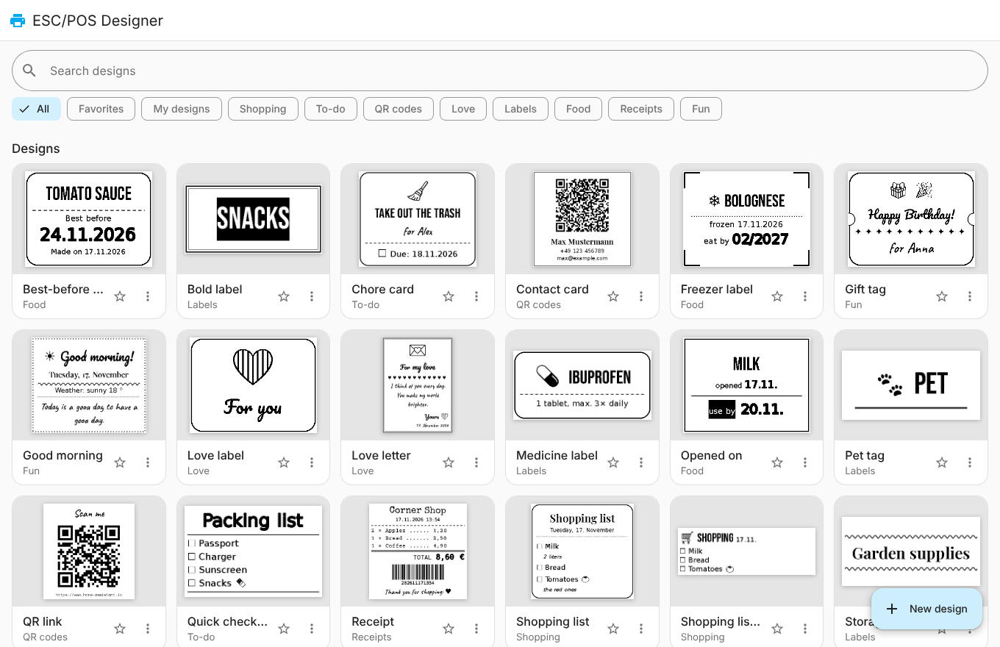
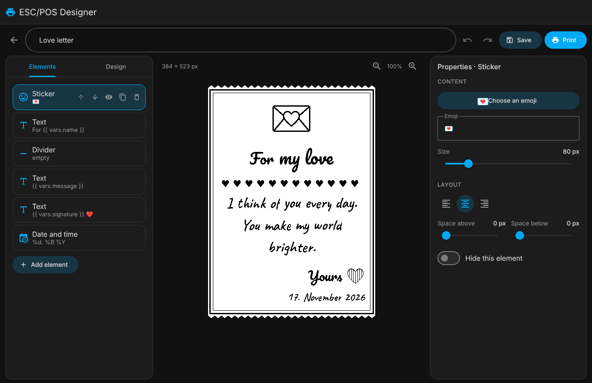

# ESC/POS Thermodrucker Designer für Home Assistant

[🇬🇧 English](README.md) · **🇩🇪 Deutsch**

<p align="center"></p>

Gestalte Etiketten, Einkaufslisten, QR-Codes, Mindesthaltbarkeits-Aufkleber und Liebesbriefe in einem modernen Web-Designer direkt in Home Assistant und drucke sie auf deinen ESC/POS-Thermodruckern.

## Highlights

- 🎨 **Ein echter Designer in deiner Seitenleiste.** Material-3-Oberfläche, die deinem Home-Assistant-Theme folgt (hell oder dunkel), auf Desktop, Tablet und Smartphone.
- 👀 **Vorschau in Originalgröße.** Die Vorschau stammt aus derselben Engine, die auch druckt, du siehst also genau das, was aus dem Drucker kommt.
- ✍️ **Rich Text pro Abschnitt.** Jeder Abschnitt einer Zeile hat eigene Schrift, Größe, Fett-, Kursiv-, Unterstrichen-, Durchgestrichen- oder Invertiert-Optik. Neun mitgelieferte Schriften von schlicht bis Handschrift, dazu Emoji.
- 📝 **Markdown-Skripte.** Schreibe einen Entwurf wie eine Notiz: Überschriften, Checklisten, Trennlinien, QR-Codes und Barcodes, mit etwas HTML für Größen, Schriften und Ausrichtung.
- 🧩 **35 fertige Entwürfe** auf Deutsch und Englisch: Einkaufs- und Todo-Listen, WLAN-Gästekarte, Kontakt-QR, Liebesbriefe (einer mit Herzchen-Rahmen), Geburtstags- und Dankeskarten, Wetter, Rezepte, Planer, Namensschilder, Mindesthaltbarkeits-, Gefrier- und Medikamenten-Etiketten, Kassenbon und mehr. Jeder fragt nur nach den Platzhaltern, und deine letzten Ausdrucke bleiben erhalten, damit du sie wiederholen oder speichern kannst.
- 🛒 **Todo-Listen direkt drucken.** Verknüpfe einen Entwurf mit einer beliebigen `todo`-Entität oder drucke sie per Skript, Dashboard oder Sprachassistent.
- 🏷️ **Etiketten und Rollen.** Papier-Voreinstellungen für 58-mm- und 80-mm-Rollen sowie Etiketten fester Größe, Rahmen, Drehen, Spiegeln und Invertieren.
- 🕘 **Deine letzten zehn Kreationen** sind beim Erstellen eines neuen Entwurfs einen Klick entfernt. Favoriten, Duplikate und eigene Entwürfe liegen in Home Assistant.
- 🔌 **Arbeitet mit der Integration ESC/POS Thermal Printer**, dem Original oder einem Fork. Fehlt sie, führen dich der Einrichtungsdialog und ein Hinweis im Designer zu ihrem HACS-Eintrag.
- 🌍 **Spricht deine Sprache.** Deutsch und Englisch, passend zur Home-Assistant-Sprache.

## Voraussetzungen

- Home Assistant 2025.1 oder neuer
- Die Integration [ESC/POS Thermal Printer](https://github.com/cognitivegears/ha-escpos-thermal-printer) mit mindestens einem Drucker. Der Designer erkennt sie selbst; fehlt sie, führt dich der Einrichtungsdialog direkt zu ihrem HACS-Eintrag.

## Installation

1. Suche in HACS (Home Assistant 2026.10 und älter) oder unter **Einstellungen → Marketplace** (2026.11 und neuer) nach **ESC/POS Thermal Printer Designer**, oder nutze diesen Button: [](https://my.home-assistant.io/redirect/hacs_repository/?owner=seb5594&repository=hass-escpos-thermal-printing-designer-integration&category=integration). Findet die Suche es nicht, füge dieses Repository am selben Ort zuerst als benutzerdefiniertes Repository hinzu (Kategorie **Integration**). Lade es dann herunter.
2. Starte Home Assistant neu.
3. Gehe zu **Einstellungen → Geräte & Dienste → Integration hinzufügen** und wähle **ESC/POS Thermal Printer Designer**.
4. Öffne **Printer Designer** in der Seitenleiste.

Ist die Drucker-Integration noch nicht installiert, sagt dir das der Einrichtungsdialog und verlinkt sie. Installiere sie über HACS, starte Home Assistant neu und wähle **Absenden**. Unter **Einstellungen → Reparaturen** erscheint außerdem ein Hinweis, solange noch kein Drucker eingerichtet ist.

Standardmäßig dürfen nur Administratoren den Designer nutzen, weil Vorlagen Entitätszustände auslesen können. In den Optionen der Integration lässt sich das abschalten, damit alle im Haushalt gestalten und drucken können; dort kann auch der Seitenleisten-Eintrag ausgeblendet werden.

## Den Designer benutzen

<p align="center"></p>

1. Wähle in der Galerie einen Entwurf oder drücke **Neuer Entwurf**. Der Dialog zeigt auch deine letzten zehn Kreationen.
2. Füge Elemente hinzu: Text, Markdown-Skript, Datum, Liste, Trennlinie, QR-Code, Barcode, Bild, Sticker oder Abstand. Ziehe sie in die richtige Reihenfolge.
3. Ändere das gewählte Element im Bereich **Eigenschaften**. Der Reiter **Entwurf** enthält Papier, Rahmen, Ränder, Druckoptionen und die Eingabewerte der Vorlage.
4. **Speichern**, oder **Drucken** drücken, Drucker wählen, Werte eintragen und die Vorschau ansehen.

Rückgängig und Wiederholen sind `Strg+Z` / `Strg+Y`, Speichern ist `Strg+S`.

### Eingabewerte und Vorlagen

Texte verstehen [Home-Assistant-Vorlagen](https://www.home-assistant.io/docs/configuration/templating/). Die Werte, die ein Entwurf abfragt, stehen als `vars.<name>` bereit:

```jinja
Haltbar bis {{ (now() + timedelta(days=vars.days | int(0))).strftime('%d.%m.%Y') }}
Draußen: {{ states('sensor.aussentemperatur') }} °C
```

### Markdown-Skripte

```markdown
<center>
# Einkauf ❤️
</center>
---
- [ ] Milch
- [x] ~~Brot~~
> Den <size=40>Kaffee</size> nicht vergessen
[[qr:https://example.com]]
```

Alles, was das Skript versteht, steht in der [Skript-Anleitung](docs/scripting.md).

## Automationen und Skripte

Zwei Dienste drucken gespeicherte Entwürfe:

```yaml
action: escpos_designer.print_template
data:
  template_id: "builtin:best_before_label"
  variables:
    name: Tomatensuppe
    days: 5

action: escpos_designer.print_todo_list
data:
  entity_id: todo.shopping_list
```

Beide akzeptieren optional `device_id` (den Drucker, bei nur einem Drucker unnötig) und `copies`. Die ID eines Entwurfs kopierst du über das ⋮-Menü seiner Karte im Designer oder liest sie in der [Vorlagen-Anleitung](docs/templates.md) nach.

### Blueprints

| Blueprint | | Was es tut |
|-----------|--|-----------|
| Print a designer template | [](https://my.home-assistant.io/redirect/blueprint_import/?blueprint_url=https%3A%2F%2Fgithub.com%2Fseb5594%2Fhass-escpos-thermal-printing-designer-integration%2Fblob%2Fmain%2Fblueprints%2Fscript%2Fescpos_designer%2Fprint_template.yaml) | Druckt einen gespeicherten Entwurf mit seinen Werten |
| Print the shopping list | [](https://my.home-assistant.io/redirect/blueprint_import/?blueprint_url=https%3A%2F%2Fgithub.com%2Fseb5594%2Fhass-escpos-thermal-printing-designer-integration%2Fblob%2Fmain%2Fblueprints%2Fscript%2Fescpos_designer%2Fprint_shopping_list.yaml) | Die offenen Einträge einer Todo-Liste als Checkliste |
| Print a best-before label | [](https://my.home-assistant.io/redirect/blueprint_import/?blueprint_url=https%3A%2F%2Fgithub.com%2Fseb5594%2Fhass-escpos-thermal-printing-designer-integration%2Fblob%2Fmain%2Fblueprints%2Fscript%2Fescpos_designer%2Fbest_before_label.yaml) | Produkt, Datum und Haltbarkeitsdatum aus der Haltbarkeit |
| Print a to-do list when something happens | [](https://my.home-assistant.io/redirect/blueprint_import/?blueprint_url=https%3A%2F%2Fgithub.com%2Fseb5594%2Fhass-escpos-thermal-printing-designer-integration%2Fblob%2Fmain%2Fblueprints%2Fautomation%2Fescpos_designer%2Fprint_list_on_trigger.yaml) | Jeder Auslöser: Taster, Verlassen des Hauses, eine Tür |
| Print the Wi-Fi guest card on a button press | [](https://my.home-assistant.io/redirect/blueprint_import/?blueprint_url=https%3A%2F%2Fgithub.com%2Fseb5594%2Fhass-escpos-thermal-printing-designer-integration%2Fblob%2Fmain%2Fblueprints%2Fautomation%2Fescpos_designer%2Fwifi_card_on_trigger.yaml) | Gäste scannen den QR-Code und sind online |
| Print a good-morning note | [](https://my.home-assistant.io/redirect/blueprint_import/?blueprint_url=https%3A%2F%2Fgithub.com%2Fseb5594%2Fhass-escpos-thermal-printing-designer-integration%2Fblob%2Fmain%2Fblueprints%2Fautomation%2Fescpos_designer%2Fmorning_briefing.yaml) | Datum, Wetter und ein Gedanke, jeden Morgen |

## Wie alles zusammenspielt

Der Designer zeichnet den fertigen Entwurf als 1-Bit-Bild und übergibt ihn an den Dienst `print_image` der Integration ESC/POS Thermal Printer. So sieht das Ergebnis auf jedem Drucker und jeder Verbindungsart gleich aus, und deshalb funktionieren Schriften, Emoji, QR-Codes und Bilder einfach. Die [Architektur-Notizen](docs/architecture.md) beschreiben die einzelnen Teile.

## Dokumentation

| | |
|---|---|
| [Skript-Anleitung](docs/scripting.md) | Markdown-Syntax, Inline-Tags, Vorlagen |
| [Vorlagen-Anleitung](docs/templates.md) | Die mitgelieferten Entwürfe, Eingabewerte, eigene Entwürfe |
| [Format des Entwurfsdokuments](docs/document-format.md) | Das JSON hinter einem Entwurf, für Tüftler |
| [Architektur](docs/architecture.md) | Engine, Backend und Panel |
| [Mitmachen](CONTRIBUTING.md) | Einrichtung, Tests und Konventionen |

## Danksagung

Die Schriften sind DejaVu, Playfair Display, Courier Prime, Special Elite, Bebas Neue, Caveat, Pacifico und Noto Emoji; ihre Lizenzen liegen in [`custom_components/escpos_designer/fonts`](custom_components/escpos_designer/fonts). Die Oberfläche nutzt [Material Web](https://github.com/material-components/material-web) und [Lit](https://lit.dev); die Icons stammen aus den [Material Design Icons](https://pictogrammers.com/library/mdi/).

## Lizenz

Veröffentlicht unter der [MIT-Lizenz](LICENSE).
