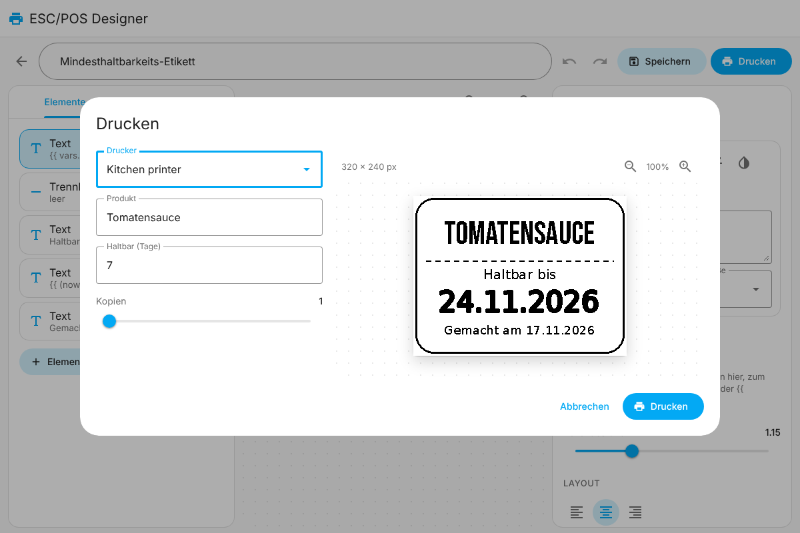
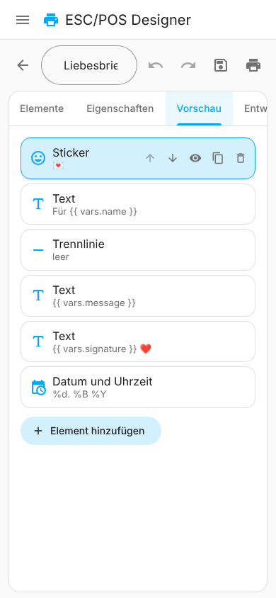

<!-- header:begin (generated from project metadata) -->
<h1 align="center">
  <picture>
    <source media="(prefers-color-scheme: dark)" srcset="https://raw.githubusercontent.com/seb5594/hass-escpos-thermal-printing-designer-integration/main/custom_components/escpos_designer/brand/dark_logo@2x.png">
    
  </picture>
  <br>
  ESC/POS Thermal Printer Designer
</h1>

<p align="center">
  <a href="https://my.home-assistant.io/redirect/hacs_repository/?owner=seb5594&amp;repository=hass-escpos-thermal-printing-designer-integration&amp;category=integration"></a>
  <a href="https://github.com/seb5594/hass-escpos-thermal-printing-designer-integration/actions/workflows/compat.yml"></a><br>
  <a href="https://github.com/seb5594/hass-escpos-thermal-printing-designer-integration/releases/tag/2026.11.20.1"></a>
  <a href="https://github.com/seb5594/hass-escpos-thermal-printing-designer-integration/releases"></a><br>
  <a href="https://github.com/seb5594/hass-escpos-thermal-printing-designer-integration/actions/workflows/ci.yml"></a>
  
  <a href="https://github.com/seb5594/hass-escpos-thermal-printing-designer-integration/issues"></a><br>
  <a href="https://paypal.me/seb5594"></a>
  <a href="https://buymeacoffee.com/seb5594"></a><br>
  <a href="https://github.com/seb5594/hass-escpos-thermal-printing-designer-integration#license"></a>
</p>
<!-- header:end -->

**🇬🇧 English** · [🇩🇪 Deutsch](README.de.md)

<p align="center"></p>

**▶ [Try the live demo](https://seb5594.github.io/hass-escpos-thermal-printing-designer-integration/)** – the real designer in your browser, no installation needed. Nothing is printed there; "Print" saves a PNG.

Design labels, shopping lists, QR codes, best-before stickers and love letters in a modern web designer inside Home Assistant, and print them on your ESC/POS thermal printers.

## Highlights

- 🎨 **A real designer in your sidebar.** Material 3 interface that follows your Home Assistant theme, light or dark, on desktop, tablet and phone.
- 👀 **WYSIWYG preview.** The preview is rendered by the same engine that prints, so what you see is what comes out of the printer.
- ✍️ **Rich text per segment.** Every segment of a line has its own font, size, bold, italic, underline, strikethrough or inverted look. Nine bundled fonts from clean to handwriting, and emoji.
- 📝 **Markdown scripting.** Write a design like a note: headings, checklists, dividers, QR codes and barcodes, with a little HTML for sizes, fonts and alignment.
- 🧩 **39 ready-made designs** in English and German: shopping and to-do lists, Wi-Fi guest card, contact QR, love letters (one framed with hearts), birthday and thank-you cards, weather, recipes, planners, name badges, best-before, freezer and medicine labels, receipts and more. Each asks only for the blanks, and your last prints are kept so you can repeat or save them.
- 🛒 **Print a to-do list directly.** Point a design at any `todo` entity, or print one from a script, a dashboard or your voice assistant.
- 🏷️ **Labels and rolls.** Paper presets for 58 mm and 80 mm rolls and fixed-size labels, frames, rotation, mirroring and inversion.
- 🕘 **Your last ten creations** are one click away when you start something new. Favorites, duplicates and your own designs are stored in Home Assistant.
- 🔌 **Works with the ESC/POS Thermal Printer integration**, the original or a fork. If it is missing, the setup dialog and a banner in the designer lead you to its HACS page.
- 🌍 **Speaks your language.** English and German, picked from the Home Assistant language.

## Requirements

- Home Assistant 2025.1 or newer
- The [ESC/POS Thermal Printer](https://github.com/cognitivegears/ha-escpos-thermal-printer) integration with at least one printer. The designer finds it by itself; if it is missing, the setup dialog links you straight to its HACS page.

## Installation

1. Search for **ESC/POS Thermal Printer Designer** in HACS (Home Assistant 2026.10 and older) or in **Settings → Marketplace** (2026.11 and newer), or use this button: [](https://my.home-assistant.io/redirect/hacs_repository/?owner=seb5594&repository=hass-escpos-thermal-printing-designer-integration&category=integration). If the search does not find it, add this repository as a custom repository (category **Integration**) in the same place first. Then download it.
2. Restart Home Assistant.
3. Go to **Settings → Devices & services → Add integration** and pick **ESC/POS Thermal Printer Designer**.
4. Open **Printer Designer** in the sidebar.

If the printer integration is not installed yet, the setup dialog says so and links to it. Install it with HACS, restart Home Assistant and press **Submit** to continue. Home Assistant also shows a hint under **Settings → Repairs** until a printer is set up.

By default only administrators can use the designer, because templates can read entity states. Turn that off in the integration's options to let the whole household design and print; the same page can hide the sidebar entry.

## Using the designer

<p align="center"></p>

1. Pick a design in the gallery or press **New design**. The dialog also lists your last ten creations.
2. Add elements: text, Markdown script, date, list, divider, QR code, barcode, picture, sticker or space. Drag them into order.
3. Change the selected element in the **Properties** panel. The **Design** tab holds paper, frame, margins, print options and the fill-in values of the template.
4. **Save**, or press **Print**, choose the printer, fill in the values and watch the preview.

<p align="center"> &nbsp; </p>

Undo and redo are `Ctrl+Z` / `Ctrl+Y`, saving is `Ctrl+S`.

### Fill-in values and templates

Texts accept [Home Assistant templates](https://www.home-assistant.io/docs/configuration/templating/). The values a design asks for are available as `vars.<name>`:

```jinja
Best before {{ (now() + timedelta(days=vars.days | int(0))).strftime('%d.%m.%Y') }}
Outside: {{ states('sensor.outside_temperature') }} °C
```

### Markdown scripting

```markdown
<center>
# Shopping ❤️
</center>
---
- [ ] Milk
- [x] ~~Bread~~
> Don't forget the <size=40>coffee</size>
[[qr:https://example.com]]
```

See the [scripting guide](docs/scripting.md) for everything the script understands.

## Automations and scripts

Two services print saved designs:

```yaml
action: escpos_designer.print_template
data:
  template_id: "builtin:best_before_label"
  variables:
    name: Tomato soup
    days: 5

action: escpos_designer.print_todo_list
data:
  entity_id: todo.shopping_list
```

Both take an optional `device_id` (the printer, not needed with one printer) and `copies`. Copy the id of a design from the ⋮ menu of its card in the designer, or look it up in the [template guide](docs/templates.md).

### Blueprints

| Blueprint | | What it does |
|-----------|--|-------------|
| Print a designer template | [](https://my.home-assistant.io/redirect/blueprint_import/?blueprint_url=https%3A%2F%2Fgithub.com%2Fseb5594%2Fhass-escpos-thermal-printing-designer-integration%2Fblob%2Fmain%2Fblueprints%2Fscript%2Fescpos_designer%2Fprint_template.yaml) | Prints any saved design with its values |
| Print the shopping list | [](https://my.home-assistant.io/redirect/blueprint_import/?blueprint_url=https%3A%2F%2Fgithub.com%2Fseb5594%2Fhass-escpos-thermal-printing-designer-integration%2Fblob%2Fmain%2Fblueprints%2Fscript%2Fescpos_designer%2Fprint_shopping_list.yaml) | The open items of a to-do list as a checklist |
| Print a best-before label | [](https://my.home-assistant.io/redirect/blueprint_import/?blueprint_url=https%3A%2F%2Fgithub.com%2Fseb5594%2Fhass-escpos-thermal-printing-designer-integration%2Fblob%2Fmain%2Fblueprints%2Fscript%2Fescpos_designer%2Fbest_before_label.yaml) | Product, date and best-before date from the shelf life |
| Print a to-do list when something happens | [](https://my.home-assistant.io/redirect/blueprint_import/?blueprint_url=https%3A%2F%2Fgithub.com%2Fseb5594%2Fhass-escpos-thermal-printing-designer-integration%2Fblob%2Fmain%2Fblueprints%2Fautomation%2Fescpos_designer%2Fprint_list_on_trigger.yaml) | Any trigger: a button, leaving home, a door |
| Print the Wi-Fi guest card on a button press | [](https://my.home-assistant.io/redirect/blueprint_import/?blueprint_url=https%3A%2F%2Fgithub.com%2Fseb5594%2Fhass-escpos-thermal-printing-designer-integration%2Fblob%2Fmain%2Fblueprints%2Fautomation%2Fescpos_designer%2Fwifi_card_on_trigger.yaml) | Guests scan the QR code and are online |
| Print a good-morning note | [](https://my.home-assistant.io/redirect/blueprint_import/?blueprint_url=https%3A%2F%2Fgithub.com%2Fseb5594%2Fhass-escpos-thermal-printing-designer-integration%2Fblob%2Fmain%2Fblueprints%2Fautomation%2Fescpos_designer%2Fmorning_briefing.yaml) | Date, weather and a thought, every morning |

## How it fits together

The designer draws the finished design as a 1-bit image and hands it to the `print_image` service of the ESC/POS Thermal Printer integration. That keeps the result identical on every printer and connection type it supports, and it is why fonts, emoji, QR codes and pictures all just work. The [architecture notes](docs/architecture.md) describe the pieces.

## Documentation

| | |
|---|---|
| [Scripting guide](docs/scripting.md) | Markdown syntax, inline tags, templates |
| [Template guide](docs/templates.md) | The built-in designs, fill-in values, making your own |
| [Design document format](docs/document-format.md) | The JSON behind a design, for tinkerers |
| [Architecture](docs/architecture.md) | Engine, backend and panel |
| [Contributing](CONTRIBUTING.md) | Setup, tests and conventions |

## Credits

The fonts are DejaVu, Playfair Display, Courier Prime, Special Elite, Bebas Neue, Caveat, Pacifico and Noto Emoji; their licenses are in [`custom_components/escpos_designer/fonts`](custom_components/escpos_designer/fonts). The UI uses [Material Web](https://github.com/material-components/material-web) and [Lit](https://lit.dev); icons are from [Material Design Icons](https://pictogrammers.com/library/mdi/).

<!-- support:begin (generated, shared text) -->
## Say thanks

All my projects are built in my spare time, just for the fun of it. Still, they take a lot of time and care, and many of the smart home gadgets I buy end up here because I want to make them cloud-free and smart-home ready. Every bit of support means a lot to me.

If my work helped you or turned out to be useful, show your appreciation with a hot drink for my next sleepless night.

[](https://paypal.me/seb5594) [](https://buymeacoffee.com/seb5594)
<!-- support:end -->

<!-- license:begin (generated from the license file) -->
## License

[](LICENSE)

Published under the [MIT License](LICENSE).
<!-- license:end -->
